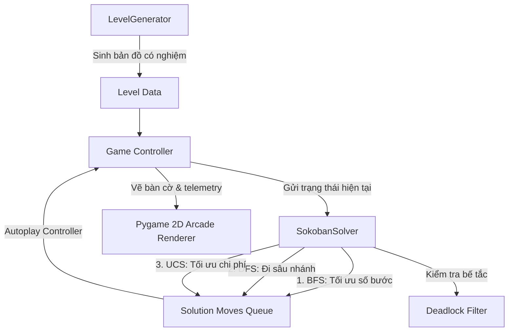

# SPIDER SOKOBAN: NGƯỜI NHỆN VÀ PHI VỤ GIẢI CỨU THẾ GIỚI
> **Game 2D Arcade - Tự động tìm kiếm lời giải bằng BFS, DFS, UCS và Sinh bản đồ ngẫu nhiên**

## 🕹️ Luật Chơi & Cơ Chế Cốt Lõi
- **Mục tiêu**: Đưa tất cả quái vật (hộp màu tím) về đúng các cổng phong ấn (vòng tròn tâm ngắm màu xanh cyan). Khi vào đúng cổng, yêu quái sẽ được chuyển sang trạng thái phong ấn an toàn (màu xanh lá).
- **Quy tắc di chuyển**:
  - Người Nhện có thể di chuyển 4 hướng: Lên, Xuống, Trái, Phải.
  - Người Nhện **chỉ có thể ĐẨY (Push)** một khối quái vật khi ô phía sau quái vật là ô trống; **không thể KÉO (Pull)**.
  - Người Nhện **không thể đẩy 2 khối quái vật cùng một lúc**, không thể đi xuyên tường hay đẩy khối vào tường.
- **Tính toán bước đi**:
  - `Bước đi (Moves)`: Số lần Người Nhện dịch chuyển vị trí.
  - `Lượt đẩy (Pushes)`: Số lần Người Nhện thực hiện hành động đẩy quái vật.
- **Trạng thái bế tắc (Deadlock)**: Nếu một quái vật bị đẩy vào góc tường (hai cạnh giáp tường) mà vị trí đó không phải là cổng phong ấn, màn chơi sẽ rơi vào trạng thái bế tắc vĩnh viễn (Deadlock) và không thể giải được nữa. Người chơi cần dùng tính năng Hoàn tác (Undo) hoặc Làm mới (Reset).

---

## 1. KIẾN TRÚC TỔNG THỂ



---

## 2. CÔNG NGHỆ SỬ DỤNG

| Thành phần | Công nghệ / Thư viện | Vai trò chi tiết trong dự án |
| :--- | :--- | :--- |
| **Ngôn ngữ cốt lõi** | `Python 3.10+` | Sử dụng kiểu dữ liệu hiện đại, `type hinting`, `dataclasses`, `tuple unpacking`, tối ưu hóa logic hướng đối tượng. |
| **Đồ họa & Âm thanh / GUI** | `Pygame 2.x` | Xây dựng Game Loop 120 FPS, xử lý tương tác bàn phím/chuột, Render đồ họa 2D phong cách Arcade Comic, vẽ gradient nền và đổ bóng vector. |
| **Hàng đợi BFS** | `collections.deque` | Hàng đợi 2 đầu FIFO (First In First Out) với độ phức tạp $O(1)$ cho thao tác `append` và `popleft`, tối ưu tốc độ duyệt theo chiều rộng. |
| **Hàng đợi ưu tiên UCS** | `heapq` (Min-Heap) | Cấu trúc dữ liệu Min-Heap nhị phân phục vụ thuật toán tìm kiếm chi phí cực tiểu với chi phí thêm/lấy phần tử $O(\log N)$. |
| **Lưu trữ trạng thái băm** | `Set`, `Dict`, `Tuple` | Biểu diễn trạng thái bất biến (Immutable State) giúp băm (hashable) và kiểm tra trạng thái đã thăm (visited set) với độ phức tạp lý tưởng $O(1)$. |
| **Quản lý thời gian & Benchmark** | `time.perf_counter` | Đo đạc chính xác thời gian thực thi thuật toán tới mức nano/micro giây. |
| **Hệ thống Font chữ Unicode** | `pygame.font` & Dynamic Fallback | Tự động quét và nạp các bộ font hệ thống (Segoe UI, Tahoma, Arial) để hỗ trợ tiếng Việt có dấu chuẩn xác 100%. |

---

## 3. TÍNH NĂNG NỔI BẬT CỦA DỰ ÁN

1. **Bộ Ba Thuật Toán Tìm Kiếm Tự Động (Autonomous Solvers)**:
   - **BFS (Breadth-First Search)**: Tự động tìm đường giải tối ưu nhất về số bước đi ($O(b^d)$).
   - **DFS (Depth-First Search)**: Duyệt nhánh theo chiều sâu, khám phá giải pháp nhanh nhưng có thể đường đi dài.
   - **UCS (Uniform Cost Search)**: Tìm kiếm đường đi có tổng chi phí thấp nhất dựa trên ma trận trọng số (bước đi tự do có trọng số $1$, bước đẩy thùng chịu lực có trọng số $2$).
2. **Cơ Chế Autoplay Trực Quan Hóa Từng Bước (Algorithm Visualization)**:
   - Sau khi giải thuật tìm được chuỗi hành động, hệ thống tự động điều khiển Người Nhện di chuyển từng ô theo thời gian thực ($0.13s/\text{bước}$) giúp người xem quan sát trực quan từng quyết định của AI.
3. **Thuật Toán Sinh Màn Chơi Tự Động Luôn Có Nghiệm (Procedural Level Generator)**:
   - Áp dụng kỹ thuật **Reverse Simulation (Kéo ngược hộp từ đích)** để khởi tạo màn chơi ngẫu nhiên.
   - Đảm bảo 100% màn chơi sinh ra đều tồn tại ít nhất một lời giải hợp lệ (solvable), không bao giờ bị kẹt ngay từ đầu.
   - Cấu hình thông minh: Giới hạn tối đa **5 block tường phụ** và **3 yêu quái**, đảm bảo độ khó vừa phải, không gian trạng thái không bị bùng nổ vô tận.
4. **Hệ Thống Nhận Diện Bế Tắc Góc (Corner Deadlock Detection)**:
   - Tích hợp hàm kiểm tra bế tắc ngay trong quá trình mở rộng trạng thái (`deadlock pruning`), lập tức loại bỏ các nhánh đẩy hộp vào góc tường không phải đích, giảm đáng kể hệ số phân nhánh.
5. **Cơ Chế Hoàn Tác Không Giới Hạn (Undo System)**:
   - Ứng dụng cấu trúc dữ liệu `Stack` ghi lại lịch sử trạng thái `(player_pos, boxes_pos, pushes)`, cho phép người chơi lùi lại từng bước không giới hạn.
6. **Đo Đạc & Thống Kê Hiệu Năng Thời Gian Thực (Real-time Telemetry Panel)**:
   - Hiển thị trực tiếp: Số trạng thái đã mở rộng (`Expanded Nodes`), kích thước hàng đợi lớn nhất (`Peak Frontier`), thời gian giải (`Elapsed Time`) và tổng số bước đi (`Path Length`).

---

## 4. KỸ NĂNG ĐẠT ĐƯỢC THÔNG QUA DỰ ÁN 

### 4.1 Những kỹ năng cốt lõi học được thông qua dự án
- **Kỹ năng Mô hình hóa bài toán thế giới thực thành Không gian trạng thái (State-Space Formulation)**:
  - Hiểu cách trừu tượng hóa một trò chơi thành tập bộ ba $(S_0, Actions(s), GoalTest(s), Cost(s, a, s'))$.
- **Kỹ năng Thiết kế Cấu trúc Dữ liệu Bất biến (Immutable Data Structures)**:
  - Nhận biết lý do vì sao không thể dùng danh sách lồng nhau `list[list]` để lưu trạng thái AI. Học cách chuẩn hóa trạng thái thành `tuple[Vec, tuple[Vec, ...]]` có thể băm (`hashable`) để tra cứu trong `Set` và `Dict` với tốc độ $O(1)$.
- **Kỹ năng Phân tích Độ phức tạp Thuật toán Không gian & Thời gian (Time & Space Complexity)**:
  - Thấy rõ sự đánh đổi (trade-off) giữa thời gian tính toán và bộ nhớ RAM thông qua kích thước của `Frontier` và số nút `Expanded`.
- **Kỹ năng Cắt tỉa không gian trạng thái (Search Pruning & Heuristic Thinking)**:
  - Biết cách áp dụng các quy tắc logic (như Deadlock Detection) để triệt tiêu các nhánh vô nghiệm trước khi duyệt sâu.
- **Kỹ năng Thiết kế Kiến trúc Game Engine & Vòng lặp sự kiện (Game Loop Architecture)**:
  - Phân tách mạch lạc giữa logic bài toán (Model/Solver), giao diện đồ họa (View/Renderer), và điều khiển tương tác (Controller).

## 5. HỆ THỐNG CHI TIẾT (FOLDER SCREENSHOTS  ) 

## 6. HƯỚNG DẪN CÀI ĐẶT & TRẢI NGHIỆM

### 6.1 Yêu cầu môi trường
- Python 3.9 trở lên
- Thư viện `pygame`

### 7.2 Cài đặt & Khởi chạy
```bash
pip install pygame
# Khởi chạy game
python Sokoban_spider.py
```